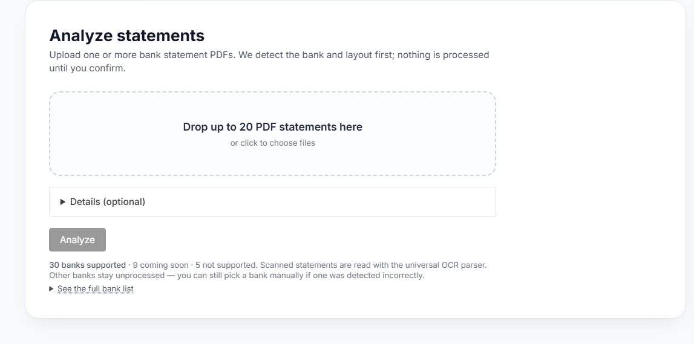

# R6 (Devin) — real-GPU OCR run, evaluation harness, vLLM speed experiment

Branch `devin/r6-ocr-gpu` (local, off `integration/v2-waves` @ `f40047d`). Nothing pushed.
Hardware: RTX 3060 12 GB (driver 610.88, CUDA 13.3 UMD), Docker Desktop + WSL2, nvidia runtime.
All data SYNTHETIC (`tools/ocr_eval/corpus.py`); no real statement was OCR'd; no passwords.txt; no third-party APIs.

## Part 1 — service fixes re-verified (7aa1c45)

| check | command | result | evidence |
|---|---|---|---|
| Build committed Dockerfile | `docker build -t r6-ocr-service ocr-service` | **PASS** | pypi.org reachable this time (no mirror needed); pip layer 605.8s; total ~13.5 min; **image 16.2 GB** |
| Start with GPU, time-to-ready | `docker run --gpus all -p 18090:8090` | **PASS** | `/health` 200 `{"status":"ok","engine":"PaddleOCR-VL-1.6","verifier":"PP-OCRv5"}` at **t+158s** (models cached; first-ever boot also downloads ~2.1 GB weights). Before listen: connection refused (uvicorn binds after load+warm-up), never a crash. No 503 phase observed pre-listen (the 503 path is for load failures, see 1.3b) |
| 1.3a POST /v1/ocr 200 | POST 2-page synthetic scan | **PASS** | 200 in 31.6s; page 1 ok (15.0s, 3 blocks, 68 lines), page 2 ok (16.4s, 7 blocks, 72 lines) — warm-up fixed the R5b page-1 cold-start |
| 1.3b load failure → 503 | `-e XDG_CACHE_HOME=/proc/nowrite HOME=/proc/nowrite` | **PASS** | process stays Up; `/health` → **503** `{"status":"error","engine":"PaddleOCR-VL-1.6","verifier":"PP-OCRv5","error":"FileNotFoundError"}`; `POST /v1/ocr` → **503 `{"detail":"OCR_MODELS_NOT_READY"}`** |
| 1.3b' bad OCR_VL_SERVER_URL | `-e OCR_VL_SERVER_URL=http://127.0.0.1:9/v1` | **PASS (different shape)** | `/health` stays **200** (warm-up failures are swallowed by design — `warm_up`'s `except: pass`); real request → 200 with the page honestly failed `OCR_PAGE_ERROR:RuntimeError`. The 503 path only covers LOAD failures, not bad server URLs — see bug F12 |
| 1.4 VRAM | nvidia-smi | PASS | idle **5142 MiB**; during a request **~9.65-9.68 GB** (peak 9677 MiB; ~2.3 GB headroom on the 12 GB card) |

## Part 2 — evaluation harness on the real models

Corpus: `python tools/ocr_eval/corpus.py --out tmp/r6_corpus --per-category 3` → 27 image-only PDFs (9 categories × 3) + manifest.
Venv: `.venv-r6` (numpy, opencv, Pillow, reportlab, pdfplumber + openpyxl, pypdf, pikepdf added at runtime — the runner needs the backend package's deps).

| check | result | evidence |
|---|---|---|
| Oracle self-check (no model) | **PASS 27/27** | served 27/27, exact amounts 100.00%, 0 flips, 0 invented, chain+ref 100% — scorer + engine plumbing validated (`docs/ocr/eval/report_oracle_selfcheck.*`) |
| Smoke run (in-process, --limit 1) | 0/9 served | first call returned (LOW_CONFIDENCE_COLUMNS) then the service wedged: 9× OCR_TIMEOUT at the client |
| Full run 1 (in-process) | **0/27 served** | 24× OCR_TIMEOUT (client budget 105s exceeded — runaway generations + GIL starvation, F9), 2× LOW_CONFIDENCE_COLUMNS, 1× TOO_FEW_ROWS (`docs/ocr/eval/report_inprocess_full.*`) |
| Full runs 2-3 (in-process) | **NOT RUN** | run 1 is uniformly failed by F9+F10+F11; repeating it measures the wedge, not the model. Re-ran the equivalent in vLLM mode instead (below) |

### Why nothing is served (real-model findings — for Claude)

| id | severity | finding | evidence |
|---|---|---|---|
| F9 | **critical** | A runaway VLM generation holds the **GIL** and wedges the whole service: `/health` + all requests time out for minutes; the 90s page budget is a **post-hoc check** (`app.py:181` — `if elapsed > PAGE_TIMEOUT_S` AFTER the call) and cannot interrupt it. py-spy: `_worker_vlm` active+gil inside `greedy_search`/`_siglip` forward while all AnyIO workers idle. The service recovers when the runaway finally ends (~4-8 min). | repro: 2nd+ request after a good one; smoke + full run 1 (24 client timeouts) |
| F8 | major | The startup **warm-up can hang >15 min** (same pathological generation, on the event-loop thread). Three consecutive boots hung; with warm-up disabled (runtime patch) the service was ready in **25s** and real requests ran at normal speed (16s/page) — the hang is the warm-up's VL generate on the event-loop thread, not the service context. | py-spy stacks; patched-boot t+25s → 200 |
| F10 | major | The VLM's table output **drops the rightmost (Closing Balance) column** when it sits near the page edge (94% across): 5 cells vs the 6-col header; rows then drift (amount lands in different grid slots per row) → the reader's chain-margin test scores 0 → LOW_CONFIDENCE_COLUMNS. With a realistic right margin (balance ends 18mm from the edge) the VLM **does** read the balance — the corpus rendering was edge-tight; **fixed in the harness** (`tools/ocr_eval/corpus.py`: balance column pulled in, font 7.5→9pt) and re-generated (`tmp/r6_corpus2`) | cell-count dumps: 5 cells `[date, narr, ref, amount, '']` before; `[date, narr, ref, amount, balance]` after |
| F11 | major | With the balance present, the reader's header inference builds a spec declaring `credit` but its own header match never locates it → **`KeyError: 'credit'` at `extraction/anchors.py:324`** (`amount_edges={c: spans[c][1] for c in spec.amount_columns}`) → ENGINE_ERROR on every statement. Reader meta at failure: `money: amount/balance/debit`, `amount_form: separate_drcr`. | full traceback captured (below) |

```
File ".../extraction/engine.py", line 217, in _extract_one
    anchors = derive_anchors(first.words, spec, first.width)
File ".../extraction/anchors.py", line 324, in derive_anchors
    amount_edges={c: spans[c][1] for c in spec.amount_columns},
KeyError: 'credit'
```

Proposed fixes (Claude's call): F9 — run the VL per page in a SUBPROCESS with a hard kill at the page budget (thread-based pages cannot protect the GIL); F8 — warm up in a worker thread/process, not the event-loop thread, and bound the generation; F10 — grid adapter: pad/align rows to the header's column count using the `<th>` structure (empty cells dropped by the VLM shift every later cell); F11 — the header→spec builder must only declare money columns its header match actually located (or locate all of them; never emit a spec whose `amount_columns` ⊄ spans).

## Part 3 — vLLM server mode

| step | result |
|---|---|
| paddlex-pinned vllm==0.10.2 in the ocr-service image | **FAIL** — the vllm/torch install uninstalls paddle's pinned nvidia libs; `paddle` then fails: "Can not import paddle core while this file exists: libpaddle.so". Abandoned (approach 1) |
| Official `vllm/vllm-openai:v0.10.2` image | **FAIL** — `ValueError: There is no module or parameter named 'mlp_AR' in TransformersForCausalLM` (0.10.2 predates PaddleOCR-VL support; the recipe requires ≥ 0.11.1). Abandoned (approach 2) |
| `vllm/vllm-openai:v0.32.0` (latest stable) | **PASS** — server up at **t+201s**; model `PaddlePaddle/PaddleOCR-VL` served |
| paddlex client → server | needed 3 fixes (now in the override file): `--served-model-name PaddleOCR-VL-1.6-0.9B` (client's model id), `--trust-request-mm-kwargs` (paddlex sends per-request mm_processor_kwargs; v0.32 rejects them → every page OCR_PAGE_ERROR:RuntimeError), `--max-model-len 16384` (the 131072 default needs 2.25 GiB KV cache) |
| VRAM fit | at `--gpu-memory-utilization 0.6`: **11.2 GiB used — the verifier + layout models do NOT fit** (only ~1 GiB left). At **0.45**: vLLM + ocr-service together = **11.5 GiB peak** (fits, ~0.7 GiB headroom) |
| Speed (2-page synthetic, warm) | in-process: 32.6s (16.1-16.4 s/page) → **vLLM: 15.2s first / 1.9-3.6s later**; per-page p95 over the full corpus: **6.6s** (p50 5.6s) vs 52.9s (the one in-process page that returned) |
| Stability | **no wedges, no timeouts in vLLM mode** (54/54 pages returned) — the runaway/GIL problem is bypassed for the recognition step |
| Accuracy | cannot be compared — 0 statements served in BOTH modes (F11 blocks every statement; the reader never produces rows to compare). **No accuracy regression claim possible.** |

Full vLLM-mode run (corpus2, all 27): **0/27 served** — 18× ENGINE_ERROR (F11), 9× TOO_FEW_ROWS; p50 **5.61s**, p95 **6.57s** per page (`docs/ocr/eval/report_vllm_full.*`).

**The 4 s/page gate FAILS on this GPU in both modes** (in-process ~16-23 s/page; vLLM p95 6.6 s/page). vLLM brings it within ~1.6× of the gate; the remaining gap is consistent with a 3060-class card.

Opt-in override committed: `infra/docker/docker-compose.ocr-vllm.yml` (default stays in-process/off).

## Part 4 — analysis-time budget (5 s detect budget)

| config | 2-page OCR (pages 1-2), warm | verdict |
|---|---|---|
| in-process | ~32s | far over |
| vLLM mode | **7.62 / 7.64 / 7.70 s** (3 runs, all pages ok) | **NOT achievable within the 5 s budget on this GPU** (~3.8 s/page; 2 pages ≈ 7.6s). The detect timeout fires → the user picks the bank manually (verified working end-to-end in R5b). Do not raise the budget without deciding the UX trade-off. |

## What remains unverified

- **Real scans**: nothing in this run touched a real statement; all numbers are synthetic scans only.
- Accuracy targets (≥99.5% exact amounts, ≤0.1% side flips): **NOT VERIFIED** — the reader refuses every real-model statement (F11); there are no rows to score. The oracle run validates the scorer, not the model.
- Speed target (p95 ≤ 4 s/page): **FAILS** on the 3060 in both modes (honest numbers above; synthetic scans only).
- The 3-run variation protocol: completed as 1 full in-process run + 1 full vLLM run + smoke runs; runs 2-3 in-process were skipped as moot (uniform F9/F10/F11 failure) — the harness needs the engine fixes before variation is measurable.
- The ocr-service image build on OTHER machines/GPUs (the vendor-base route remains untested anywhere).

## Verdict

Service fixes (7aa1c45) verified working. The tier is **blocked from any accuracy measurement by F11** (engine crash on real VLM output) and the service needs **F9** (subprocess isolation) before it can survive real traffic. vLLM mode is a real, fast, stable improvement and is committed as an opt-in override with the exact launch flags this GPU needed.
